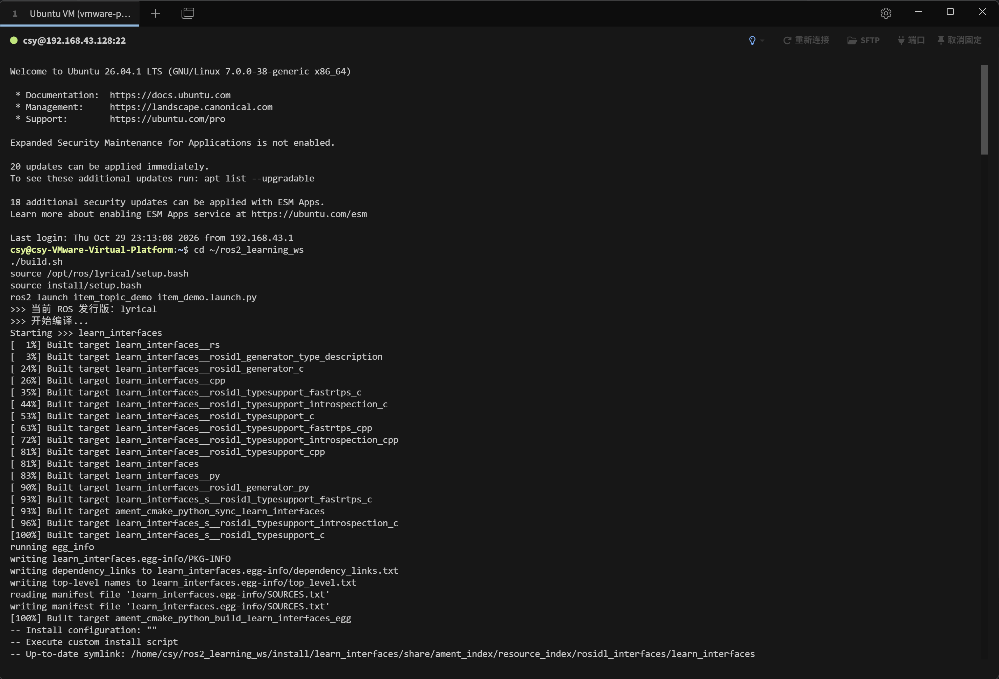

# task1 / environment

任务一：相关环境配置。

## 完成内容

1. C++ 代码环境配置，在 IDE 中运行 `hello world` 并截图（见根 README 中原有截图）。
2. 在物理机上以 VMware 虚拟机方式安装 Ubuntu，熟悉常用命令行；虚拟机内可稳定登录 GitHub。
3. 创建工作空间 `~/ros2_learning_ws`，使用 `colcon build` 编译 `learn_interfaces` 功能包，验证 ROS2 环境可用。

## 截图

### Ubuntu 环境与 colcon 编译

图中可见：

- Ubuntu 26.04.1 LTS（GNOME / Linux 7.0.0-38-generic x86_64），通过 SSH 从宿主机连接；
- 进入 `~/ros2_learning_ws` 执行 `source /opt/ros/lyrical/setup.bash` 后 `colcon build`；
- `learn_interfaces` 包从 `1%` 编译到 `100%`，并完成 `ament_cmake_python` 的 install 阶段。
