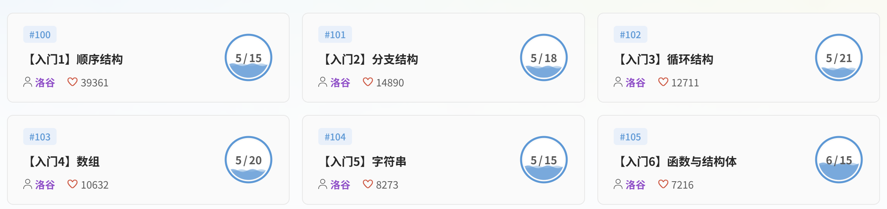

# task3 / cpp / 4 —— 入门四

第三次任务第 1 项：继续学习 C++ 基础语法，在洛谷题单广场的**入门4（数组）**中选 5 题完成，保存代码并对成功运行结果截图。

## 完成情况

- 题单：洛谷【入门4】数组（共 20 题）
- 已完成：**5 / 20**，满足「选 5 题完成」的要求
- 截图中的 5 道题均已通过评测

## 截图

## 说明

- 对应科目：#103【入门4】数组 5/20；
- 提交记录（AC 状态）见洛谷个人主页，本节仅归档题单完成进度截图。
