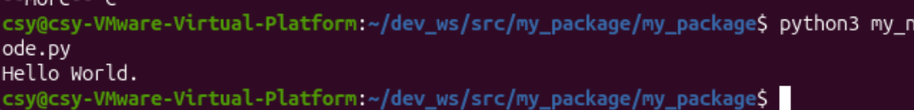

# task3 / ros / hello_world_node

任务三第 2 项：学习 ROS2 的 node，编写节点并运行，使节点输出 `Hello World`。

## 完成内容

- 在 `~/dev_ws/src/my_package` 功能包中编写节点，名为 `my_node`；
- 通过 `python3 my_node.py` 直接运行节点，终端打印 `Hello World.`；
- 工作空间为 `~/dev_ws`，功能包为 `my_package`（`my_package/my_package/my_node.py`）。

## 截图

### 节点运行结果



## 复现命令

```bash
cd ~/dev_ws/src/my_package/my_package
python3 my_node.py
# 输出：Hello World.
```
