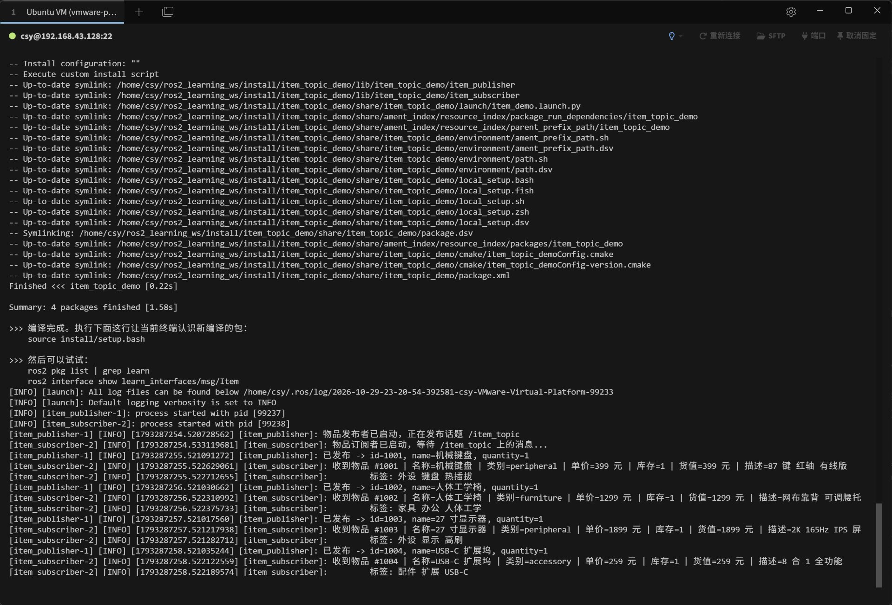

# task5 / 01_topic_custom_msg

第五次任务第 1 项：ROS2 **话题 + 自定义消息**。

## 要求

自定义消息包含某个物品的 ID 和该物品的基本信息，创建一个发布者发布该物品的信息，创建一个接收者订阅信息并打印出来。

## 实现要点

- 自定义消息 `Item`（位于 `learn_interfaces` 包），字段：

  | 字段 | 含义 | 示例 |
  | --- | --- | --- |
  | `id` | 物品 ID | `1001` |
  | `name` | 名称 | `机械键盘` |
  | `category` | 类别 | `peripheral` |
  | `price` | 单价 | `399` |
  | `stock` | 库存 | `1` |
  | `total_value` | 货值（单价 × 库存） | `399` |
  | `description` | 描述 | `87 键 红轴 有线版` |
  | `tags` | 标签 | `外设 键盘 热插拔` |

- 发布者节点 `item_publisher`、订阅者节点 `item_subscriber`，话题 `/item_topic`；
- 由 `item_topic_demo/launch/item_topic_demo.launch.py` 一次拉起两个节点。

## 截图



运行结果：

- `[item_publisher]`：物品发布者已启动，正在发布话题 `/item_topic`；
- `[item_subscriber]`：订阅者已启动，依次收到 4 件物品 —— `1001 机械键盘 / 399 元`、`1002 人体工学椅 / 1299 元`、`1003 27 寸显示器 / 1899 元`、`1004 USB-C 扩展坞 / 259 元`，并打印每个物品的类别、库存、货值、描述与标签。

## 复现命令

```bash
cd ~/ros2_learning_ws
colcon build
source install/setup.bash
ros2 launch item_topic_demo item_topic_demo.launch.py
```
