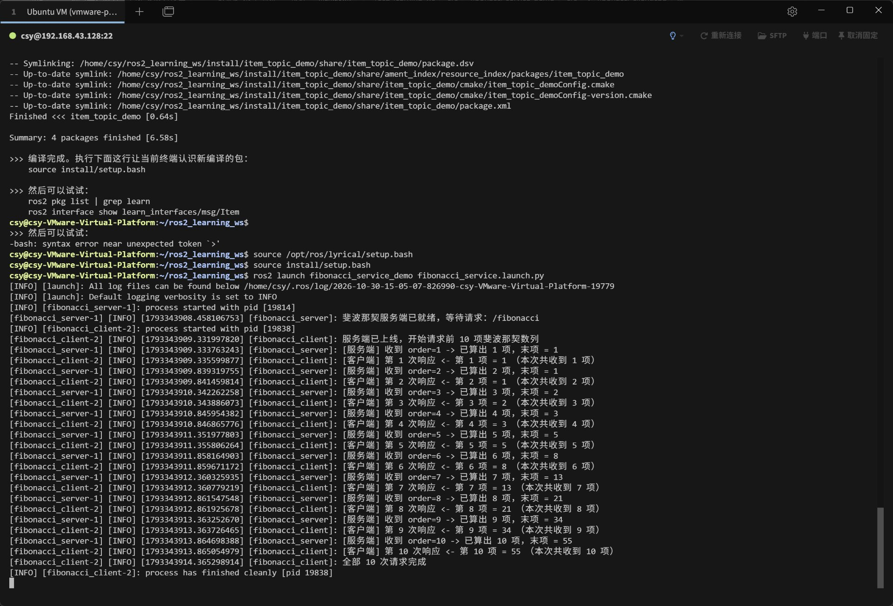

# task5 / 02_service_custom_srv

第五次任务第 2 项：ROS2 **服务 + 自定义服务接口**。

## 要求

能用 C++ 实现服务，要求服务端和客户端交替输出斐波那契数列。

## 实现要点

- 自定义服务接口 `.srv`（位于 `learn_interfaces` 包），请求字段为需要计算的项数 `order`，响应字段为该项的斐波那契数值；
- 服务端节点 `fibonacci_server`，提供服务 `/fibonacci`，就绪后打印「斐波那契服务端已就绪，等待请求」；
- 客户端节点 `fibonacci_client`，循环发起 10 次请求，每次收到结果后打印「第 N 项 = X（本次共收到 N 项）」，服务端同时打印「已算出第 N 项」；
- 由 `fibonacci_service_demo/launch/fibonacci_service.launch.py` 拉起。

## 截图



运行结果：

- 客户端依次请求 `order=1..10`，服务端与客户端交替输出；
- 数列：`1, 1, 2, 3, 5, 8, 13, 21, 34, 55`；
- 第 10 次后客户端打印「全部 10 次请求完成」，进程正常退出。

## 复现命令

```bash
cd ~/ros2_learning_ws
source /opt/ros/lyrical/setup.bash
source install/setup.bash
ros2 launch fibonacci_service_demo fibonacci_service.launch.py
```
