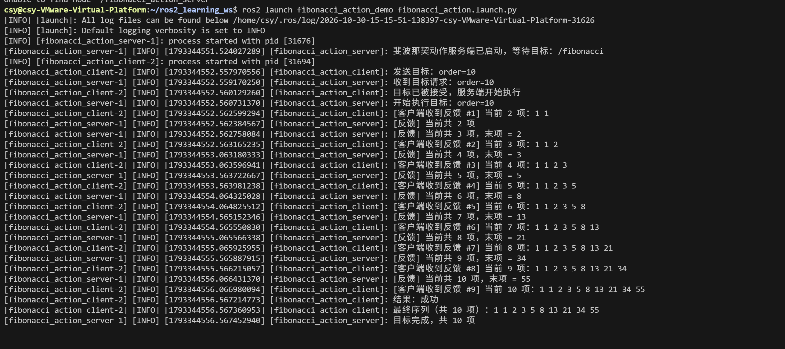

# task5 / 03_action_custom_action

第五次任务第 3 项：ROS2 **动作 + 自定义动作接口**。

## 要求

对 ROS2 的动作和自定义动作接口进行学习，创建一个动作服务端与动作客户端，执行过程中持续反馈进度，结束后返回最终结果。

## 实现要点

- 自定义动作接口 `.action`（位于 `learn_interfaces` 包）：
  - Goal：需要生成的目标项数 `order`；
  - Feedback：当前已算出的项数与最新序列；
  - Result：最终完整序列。
- 动作服务端 `fibonacci_action_server`，提供动作 `/fibonacci_action`，就绪后打印「斐波那契动作服务端已启动，等待目标」；
- 动作客户端 `fibonacci_action_client`，发送目标 `order=10`，收到目标接受后进入执行阶段；
- 由 `fibonacci_action_demo/launch/fibonacci_action.launch.py` 拉起。

## 截图



运行结果：

1. 客户端发送目标 `order=10`，服务端收到并接受，开始执行；
2. 服务端每算出一项即发布一次反馈，客户端打印「当前共 N 项」，序列逐步增长：`1 → 1 1 → 1 1 2 → … → 1 1 2 3 5 8 13 21 34 55`；
3. 第 10 项完成后客户端打印「结果：成功」「最终序列（共 10 项）：1 1 2 3 5 8 13 21 34 55」，服务端打印「目标完成，共 10 项」。

## 复现命令

```bash
cd ~/ros2_learning_ws
source /opt/ros/lyrical/setup.bash
source install/setup.bash
ros2 launch fibonacci_action_demo fibonacci_action.launch.py
```
