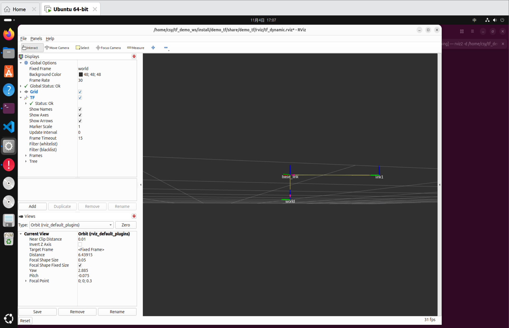

# task6 / ros2 / 02_dynamic_tf

第六次任务 ROS2 第 2 项：发布**动态 TF**，`base_link` 不动，`link1` 绕 `base_link` 一直旋转。

## 要求

创建一个发布动态 TF 的文件，要求一个 TF 为 `base_link`（不会动），另一个 TF 为 `link1`，`link1` 会绕 `base_link` 一直旋转，并在 RViz 中展示并截图。

## 实现要点

- 动态 TF 指**随时间不断更新**的坐标变换，需要在定时器里持续发布，每次发布时变换量（平移或旋转）与上一次不同；
- 在 `~/tf_demo_ws` 工作空间新建 `demo_tf` 功能包，编写 `dynamic_tf_broadcaster.cpp`，用 `tf2_ros::TransformBroadcaster` 发布变换；
- `base_link` 的变换保持恒定（不随时间改变），只有 `link1` 相对 `base_link` 的旋转量随时间递增，因此表现为 `link1` 绕 `base_link` 持续转动；
- RViz 加载 `demo_tf` 包内的 `rviz/dynamic.rviz`，`Fixed Frame` 设为 `world`，作为整个场景的固定参考系。

## 截图

两张截图取自同一次运行、同一视角，间隔若干帧：




图中可见：

- RViz 加载的是 `/home/csy/tf_demo_ws/install/demo_tf/share/demo_tf/rviz/dynamic.rviz`，`Fixed Frame` 为 `world`；
- `world` 与 `base_link` 在两个时刻的位置完全一致，对应用户要求中的“`base_link` 不会动”；
- `link1` 从 `base_link` 的左侧移动到了右侧，坐标轴朝向也随之改变，说明 `link1` 相对 `base_link` 的变换在持续更新，即绕 `base_link` 旋转。

## 复现命令

```bash
cd ~/tf_demo_ws
colcon build
source install/setup.bash

# 终端 A：启动动态 TF 广播
ros2 run demo_tf dynamic_tf_broadcaster

# 终端 B：打开 RViz 查看
rviz2 -d install/demo_tf/share/demo_tf/rviz/dynamic.rviz
```

也可以用 `ros2 run tf2_ros tf2_echo world link1` 在终端打印 `link1` 相对 `world` 的实时变换，会看到数值随旋转不断变化。
