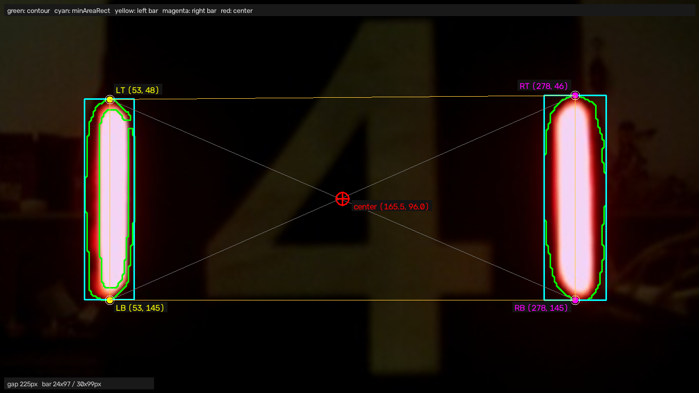
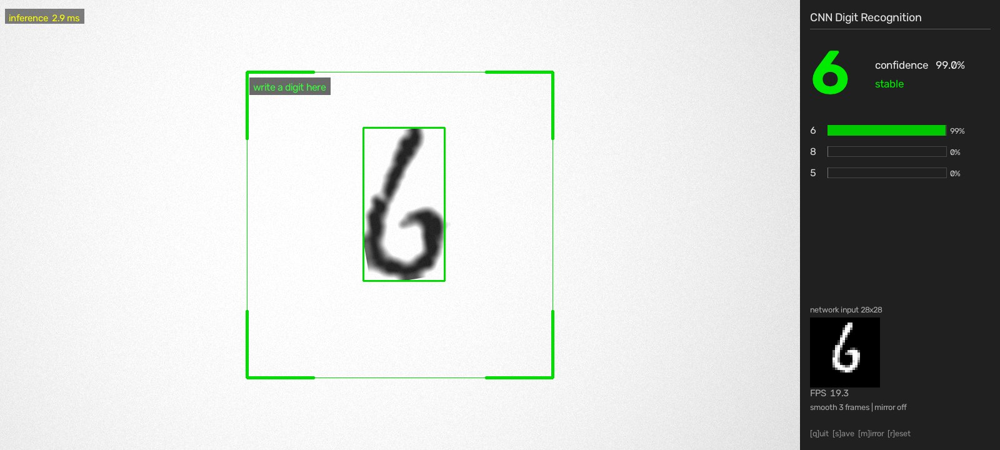

# 进阶task / nn / 01_digit_cnn

进阶任务神经网络部分：用 PyTorch 手写 CNN，完成手写数字识别，并接入摄像头做端到端实时推理。

## 要求

1. 学习 Python 基础语法；
2. 进行 PyTorch 相关环境的配置；
3. 对 CNN（卷积神经网络）结构进行理解；
4. 用 PyTorch 框架手写一个 CNN 的手写数字识别，要求：自己寻找适合数据集、对数据集进行相关预处理、在验证集上统计识别准确率、实现端到端的处理（调用摄像头进行实时识别）。

## 前置项（第 1–3 条）

这三条属于学习性要求，不产出截图，对应的掌握情况体现在第 4 条的实现里：

- **Python 基础语法**：变量与容器（`list` / `dict`）、函数、类与模块导入，训练脚本与推理脚本都按这个结构拆分；
- **PyTorch 环境配置**：安装 PyTorch 并验证可用（`torch.__version__`、可用设备查询），张量运算、`nn.Module`、`DataLoader`、优化器均能正常调用；
- **CNN 结构理解**：清楚「卷积核提取局部特征 → 激活函数引入非线性 → 池化降维 → 全连接分类」这条信息流，以及卷积层通道数、kernel size、stride 对输出尺寸的影响。

## 实现要点（第 4 条）

- **数据集**：28×28 灰度手写数字图（截图右下角 `network input 28x28` 即网络输入尺寸），用公开手写数字数据集，按比例划分训练集与验证集；
- **预处理**：图像转张量并归一化；实时推理前还要把取景框里的笔迹裁剪成正方形、缩放到 28×28，保证笔画居中、黑底白字，与训练数据分布保持一致；
- **网络结构**：卷积 + 激活 + 池化的组合堆叠提取特征，末端接全连接层输出 10 类，损失函数用交叉熵；
- **训练与评估**：共训练 8 个 epoch，每轮分别记录训练集/验证集的 loss 与 accuracy，验证集准确率作为最终指标；
- **端到端实时识别**：`cv2.VideoCapture(0)` 读取摄像头画面 → 中央方框内收集笔迹 → 预处理成 28×28 → 前向推理 → 右侧面板显示置信度与 top-3 概率。

## 截图

### 摄像头实时识别

图中可见：

- 识别结果为 **6**，置信度 **99.0%**，状态 `stable`；
- 右侧 top-3 概率：`6` 99%、`8` 0%、`5` 0%，说明模型对其余类别几乎没有误判倾向；
- 左下角给出网络输入 `28×28` 的实际图像，可见笔画已被裁好并居中；
- 性能：单帧推理 **2.9 ms**，界面整体 **19.3 FPS**；
- 界面参数：`smooth 3 frames`（对最近 3 帧结果做平滑，避免抖动）、`mirror off`（画面未镜像）；按键提示 `[q]uit`、`[s]ave`、`[m]irror`、`[r]eset`。

### 训练过程

8 个 epoch 的训练结果：

| 指标 | 起点 | 终点 |
| --- | --- | --- |
| train loss | 1.01 | 0.46 |
| val loss | 0.45 | 0.36 |
| train acc | 75% | 97% |
| val acc | 98% | 99% |

第 1 个 epoch 之后曲线快速抬升/下降，第 3–4 轮趋于平缓，末段仍在缓慢改善，说明收敛良好、还可以继续训练但收益有限。

值得注意的是**验证集准确率全程高于训练集**。常见原因是训练阶段启用了数据增强或 dropout，训练集本身更难；本例中两条曲线同步上升、差距很小，也没有出现「训练集继续升高而验证集掉头向下」的情况，因此不存在过拟合。

## 运行方式

先运行训练脚本得到权重文件，再运行实时识别脚本接入摄像头（默认 0 号设备）。窗口内按键：`q` 退出、`s` 保存当前画面对应的样本、`m` 切换镜像、`r` 清空画布重新书写。
