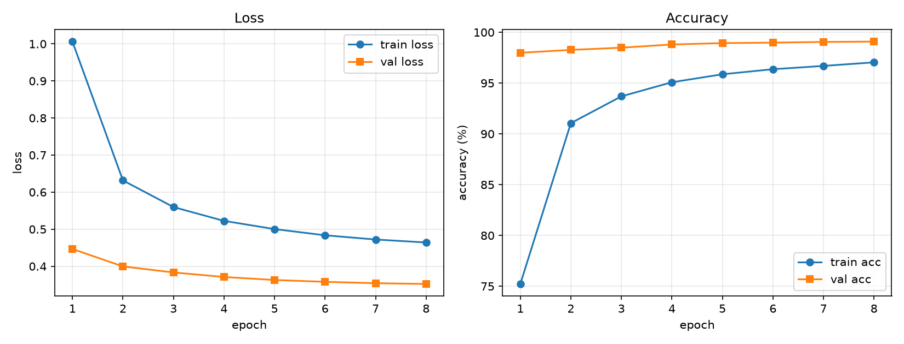

# 进阶task / opencv / 01_light_bar

进阶任务 OpenCV 第 2 项：灯条图像的轮廓提取、端点坐标输出与中心计算。

## 要求

用 OpenCV 实现灯条图像识别，完成：

1. 框出灯条轮廓；
2. 输出两个灯条上下两点一共 4 个点的坐标位置，并通过 4 点计算中心位置。

## 实现要点

- 处理流程：读入图像 → 转灰度（或取红色通道）→ 阈值分割提取高亮灯条 → 形态学开闭运算去掉噪点与粘连 → `findContours` 提取外轮廓 → `minAreaRect` 求最小外接矩形把灯条框出来；
- 每个灯条取**上下两端的中点**作为两个特征点，左右灯条共 4 点：`LT`（左上）、`RT`（右上）、`LB`（左下）、`RB`（右下）；
- 中心位置直接取 4 点坐标的算术平均，等价于两条灯条连线交点的中点，即装甲板中心；
- 图上颜色约定（画面顶部图例）：`green` 为 contour 轮廓，`cyan` 为 minAreaRect 最小外接矩形，`yellow` 为左灯条，`magenta` 为右灯条，`red` 为 center 中心。

## 截图



图中可见：

- 两个灯条的外轮廓用绿色描出，青色矩形为 `minAreaRect` 结果，黄/洋红直线连接同一灯条的上下端点；
- 4 个端点坐标：`LT (53, 48)`、`RT (278, 46)`、`LB (53, 145)`、`RB (278, 145)`；
- 中心用红色十字标出，标注为 `center (165.5, 96.0)`。

中心计算核对：

```
x = (53 + 278 + 53 + 278) / 4 = 165.5
y = (48 + 46 + 145 + 145) / 4 = 96.0
```

与图上标注一致，说明中心确实由 4 点求平均得到。左下角另有 `gap 225px`、`bar 24x97 / 30x99px` 的调试信息，分别是两灯条间距与各自的宽高。

## 运行方式

脚本读入灯条图像，处理后弹出 OpenCV 窗口显示标注结果（`cv2.imshow` + `cv2.waitKey`），按任意键关闭窗口。阈值、形态学核大小等参数在脚本开头集中定义，便于换场景时调整。
