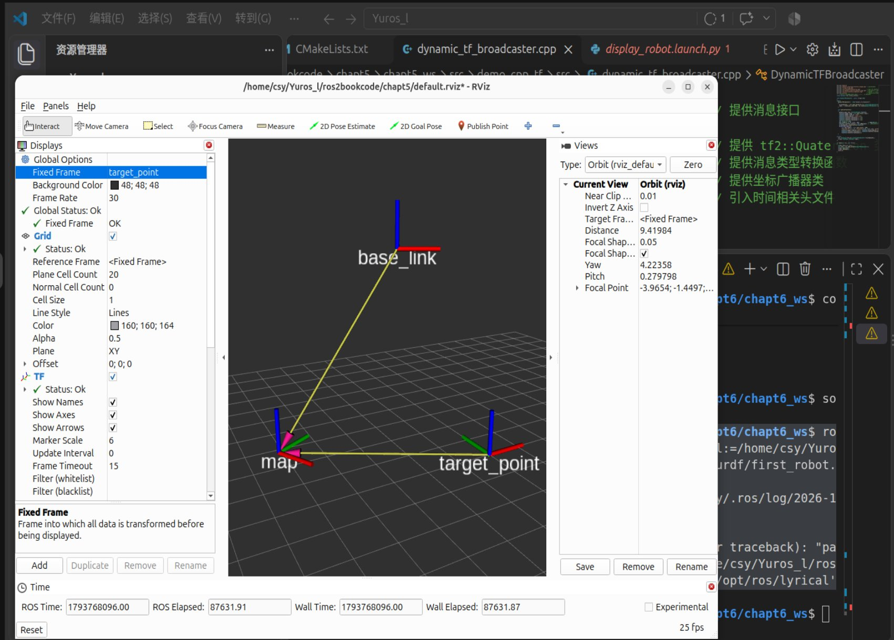

# 进阶task / ros2 / 01_static_tf

进阶任务 ROS2 第 1 项：发布**静态 TF**，并在 RViz 中展示。

## 要求

创建一个发布静态 TF 的文件，并在 RViz 中展示并截图。

## 实现要点

- 静态 TF 指**不随时间变化**的坐标变换，发布一次即可，后续任何时刻查询结果都相同，因此常用于描述传感器、相机、雷达相对车体底盘的固定安装位置；
- 本次在 `~/Yuros_ros2bookcode/chapt6` 中实践，发布的变换关系固定不变，RViz 中可见 `map`、`base_link`、`target_point` 三个坐标系；
- 三个坐标系两两之间的相对位置恒定，黄色连线表示 TF 的父子变换关系；
- RViz 加载同目录下的 `default.rviz` 配置，把 `Fixed Frame` 设为 `target_point`，打开 TF 显示项（`Show Names`、`Show Axes`）后可视化。

## 截图



图中可见：

- RViz 加载的是 `/home/csy/Yuros_ros2bookcode/chapt6/default.rviz`；
- 左侧 Displays 中 `Fixed Frame` 为 `target_point`，TF 显示项 `Status: Ok`，`Show Names`、`Show Axes` 均已勾选，`Marker Scale` 为 6；
- 视图中 `map`、`base_link`、`target_point` 三个坐标系的 RGB 三轴箭头与名称标签正常显示，黄色线段连接父子坐标系；
- 静态变换的特点在这里表现得很直接：图上的相对位置不会随刷新改变。

## 复现命令

```bash
cd ~/Yuros_ros2bookcode/chapt6
source install/setup.bash   # 已编译过可省略
rviz2 -d default.rviz
```
